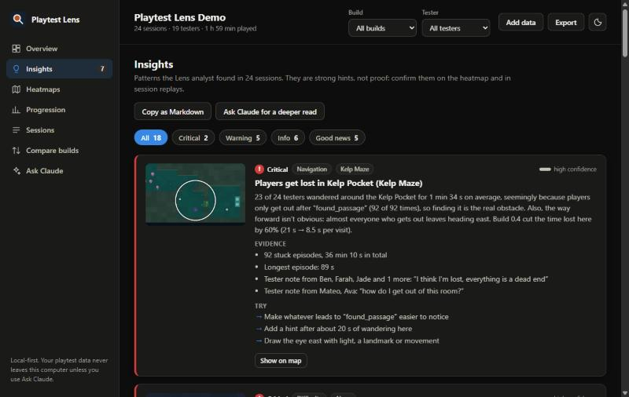
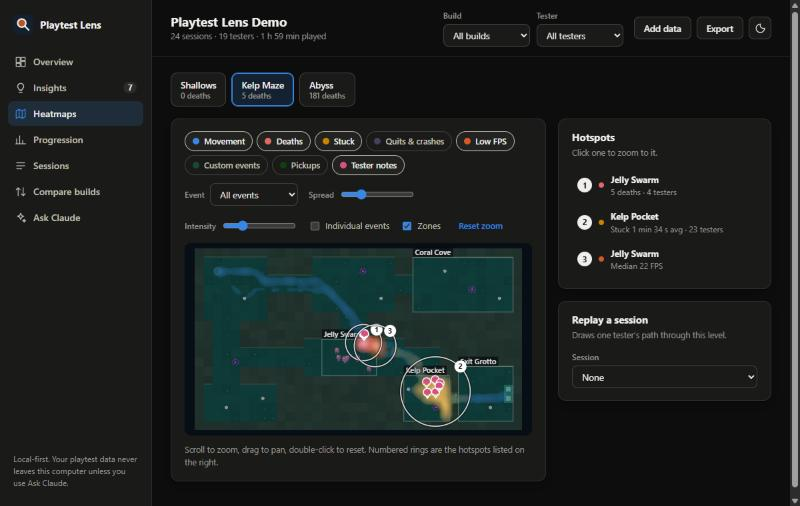
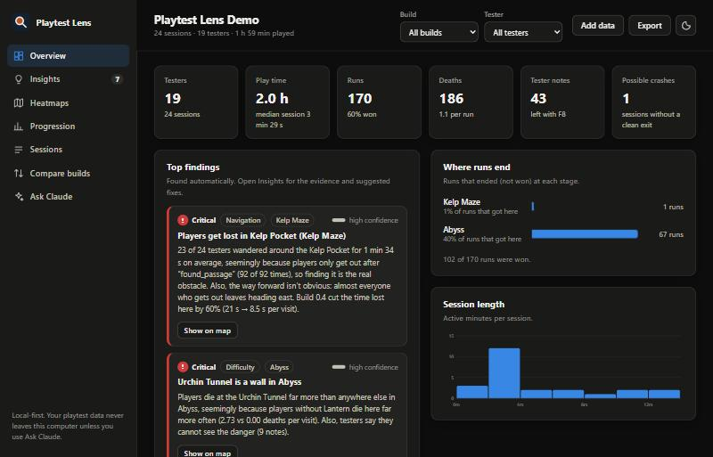

# Playtest Lens

**Local-first playtest analytics for Godot 4.** Drop the plugin into your game, send a build to testers, and see where players die, get stuck, rage-quit and lag. A built-in analyst explains the patterns in plain language: *"Players get lost in the Kelp Pocket, seemingly because they only get out after finding the hidden passage."*

Big analytics services are built for live games with accounts and servers. Playtest Lens is built for small teams running playtests: no accounts, no server, no setup. Testers press a key to export a zip; you drop it into a dashboard that works offline.



## What you get

- **Zero-code tracking.** Put your player in the group `playtest_track`. Sessions, levels (one per scene), positions, pauses, focus changes, frame rate, quits and crashes are recorded automatically.
- **One-line events** for what only your game knows: deaths, pickups, upgrade choices, runs and progress, custom moments.
- **Tester tools.** <kbd>F8</kbd> opens a note box ("I can't tell where to go"), saved with where the tester was. <kbd>F9</kbd> zips all playtest data to the Desktop for the tester to send you.
- **Automatic level maps.** A top-down picture of each level is captured in the background (2D and 3D), so heatmaps sit on your actual level.
- **An offline dashboard** with Overview, Insights, Heatmaps, Progression, Sessions, Compare builds and Ask Claude views.
- **The Lens analyst.** A rule-based engine that finds death hotspots, stuck spots, rage quits, difficulty spikes, overpowered or ignored upgrades, frame drops, crashes and build-to-build changes. It says why each one seems to happen, shows the evidence and its confidence, and suggests what to try.
- **Ask Claude (optional).** Get a written playtest report from Claude, built from aggregated numbers only, using your own Anthropic API key.
- **Private by default.** Data stays on the tester's machine until they send it to you. Nothing is uploaded anywhere unless you use Ask Claude.





## Install

Full walkthrough: [SETUP.md](SETUP.md).

Requires Godot 4.3 or newer (tested on 4.5 and 4.7).

1. Copy `addons/playtest_lens` into your project's `addons/` folder.
2. Open **Project → Project Settings → Plugins** and enable **Playtest Lens**. This adds the `PlaytestLens` autoload and a **Playtest Lens** bottom panel.
3. Add your player node to the group **`playtest_track`** (Node dock → Groups).
4. Run the game, play for a bit, then click **Open Dashboard** in the Playtest Lens panel.

## Report the moments that matter

```gdscript
PlaytestLens.death("spikes")                     # position comes from the tracked player
PlaytestLens.item("double_jump")
PlaytestLens.choice("upgrade", ["lantern", "fins", "shell"], "lantern")
PlaytestLens.event("boss_phase_2")               # any custom moment gets its own heatmap layer
PlaytestLens.feedback("Testers can also leave notes in code")
```

Roguelites and other run-based games get run statistics ("most runs end on Day 3", "runs with the Lantern win 83% of the time"):

```gdscript
PlaytestLens.run_start()
PlaytestLens.progress(3, "Day 3")                # a growing number plus the label to show
PlaytestLens.run_end("death")                    # or "win", "quit", ...
```

| Call | What it records |
|---|---|
| `death(cause = "", data = {}, position = null)` | A death. Shown on the Deaths layer and analysed per hotspot. |
| `item(id, data = {}, position = null)` | A pickup. |
| `choice(kind, options, picked, data = {})` | An offered choice and the pick. Powers pick rates and win rates with and without each option. |
| `event(name, data = {}, position = null)` | Any custom moment. The analyst notices when deaths follow it ("85% of deaths come within 3 s of dash"). |
| `run_start(data = {})`, `run_end(outcome = "death", data = {})` | One attempt in a run-based game. |
| `progress(value, label = "", data = {})` | How far the current run got. |
| `set_level(id, data = {})`, `level_complete()`, `level_failed()` | Levels that are not separate scenes (procedural rooms, days, waves). After the first `set_level`, scene changes stop starting levels automatically. |
| `feedback(text)`, `open_feedback()` | A tester note from code, or open the note box. |
| `set_tester(name)`, `set_attribute(key, value)` | A readable tester name, or a fact about the session such as difficulty or input device. |
| `track(node, id = "")`, `untrack(node)` | Track nodes without using the group. Several tracked nodes are supported. |
| `capture_map(level_id = "", rect = null, force = false)` | Capture the map now, optionally for a `Rect2` (2D) or `AABB` (3D). |
| `export_data()`, `open_data_folder()`, `is_recording()` | The same as F9, open `user://playtest_lens`, and check that recording is on. |

Every call is safe to leave in shipping code. When recording is off, the calls do nothing.

### Name the places that matter

Insights read much better with names ("players die at the Spike Gate" rather than "near (812, 431)"). Add an `Area2D` or `Area3D` with a collision shape to the group **`playtest_zone`**. Its node name, or a `zone_name` metadata entry, becomes the label. Zones are drawn on the heatmap too.

### Maps

A map picture is captured one second after each level starts, once per level per build. Captures need a window, so headless runs skip them. The plugin works out the level bounds from tile maps, sprites, polygons and collision shapes. For exact 2D bounds, add a `get_playtest_bounds() -> Rect2` method to any node in the level. Put nodes that shouldn't appear in captures, such as other characters, in the group `playtest_map_ignore`. Tracked nodes are hidden automatically.

## Running a playtest

1. Export a build as usual. Recording is on in exported builds unless you turn it off (see Settings).
2. Tell testers: press **F8** to leave a note any time, and press **F9** at the end. F9 saves a zip to their Desktop for them to send you.
3. In Godot, open the **Playtest Lens** panel, click **Import Tester Data…** and pick the zip (or a `playtest_lens` folder, or `.jsonl` files).
4. Click **Open Dashboard**. It builds a single self-contained HTML file with all local and imported data and opens it in your browser. You can share that file with your team.

You can also open `addons/playtest_lens/dashboard/index.html` directly and drag zips, folders or session files onto it. **Add data → Load sample data** shows a full example.

Command-line options (after `--`): `--playtest-tester=Sam`, `--playtest-build=0.5`, `--playtest-off`, `--playtest-on`.

### Automatic uploads (no zips to send)

With a free Google Drive collector, testers' games upload sessions in the background, after asking them once. Click **Sync Testers** in the Playtest Lens panel (or turn on auto-sync) to pull everything into the dashboard. Setup takes about 10 minutes: see [docs/CLOUD_SYNC.md](docs/CLOUD_SYNC.md).

## The dashboard

| View | What it shows |
|---|---|
| Overview | Testers, play time, runs, deaths, notes and crashes; top findings; where runs end; session lengths; per-level table. |
| Insights | Every finding with severity, confidence, evidence and suggestions, plus a map thumbnail. Copy as Markdown for your team. |
| Heatmaps | Movement, deaths, stuck, quits and crashes, low FPS, custom events, pickups and tester notes over the level map. Zones, ranked hotspots, zoom and pan, and session replay. |
| Progression | How runs end, how far they get, where they end, per-level clear rates, upgrade pick and win rates, death causes and pickups. |
| Sessions | Every session with a timeline of levels, deaths, notes, choices and pickups. |
| Compare builds | Metrics and hotspots side by side, marked better or worse, so you can see whether a change helped. |
| Ask Claude | A written report from Claude, optional. |

### What the analyst looks for

- **Death hotspots**, grouped by zone, with the most likely reason: an upgrade that changes the death rate (tested for significance), frame drops at the spot, a custom event just before deaths, deaths within 1.5 s of arriving, players arriving unusually fast, many attempts without getting past, or tester notes about lag or visibility.
- **Stuck spots**: players wandering at least 10 s in a small area while moving. It notes which event usually comes right before players get out, which way they leave, quits while stuck, and "I'm lost" notes. Pauses at one spot are reported separately as hesitation.
- **Quit hotspots and rage quits**: sessions ending at the same place, and quits within 45 s of a death.
- **Difficulty spikes**: stages where far more runs end than elsewhere.
- **Balance**: upgrades that seem to decide runs, trap picks, and options nobody picks.
- **Performance**: frame drops per zone and per GPU.
- **Stability**: sessions that ended without a clean exit, and where.
- **Build changes**: hotspots, stuck time, win rate, frame rate and crashes compared with the previous build. When a newer build fixed a hotspot, the original finding says so.
- **Good news**: levels that play smoothly and crash-free builds.

Findings are hints backed by numbers, not proof. Every card links to the map so you can check it.

### Ask Claude

On the Ask Claude tab, paste an Anthropic API key (from console.anthropic.com) and click Analyze. The dashboard loads the official Anthropic SDK and streams a report from Claude Opus 5.5 by default. It sends only aggregated statistics, the analyst's findings and tester notes; **Preview exactly what will be sent** shows the payload. Requests go straight from your browser to Anthropic and are billed to your account. A typical report costs a few cents. The key is kept only if you tick "Remember".

## Settings

Project Settings → **Playtest Lens**:

| Setting | Default | |
|---|---|---|
| `general/enabled` | on | Master switch. |
| `general/record_in_editor` | on | Record when you run from the editor. |
| `general/record_in_exported_builds` | on | Record in exported builds. **Turn off for your public release.** |
| `general/build_label` | empty | Build name for comparisons. Defaults to `application/config/version`. |
| `tracking/sample_interval` | 0.5 s | How often positions are sampled. |
| `tracking/auto_level_from_scene` | on | Each scene is a level. |
| `performance/record_performance` | on | Sample the frame rate, frame time and memory. |
| `performance/interval` | 2 s | How often. |
| `maps/auto_capture` | on | Capture level maps automatically. |
| `maps/max_size` | 2048 px | Largest map side. |
| `maps/capture_delay` | 1 s | Wait after a level starts before capturing. |
| `tester/feedback_key` | F8 | Note box key (empty disables it). |
| `tester/export_key` | F9 | Export key (empty disables it). |
| `tester/show_recording_indicator` | off | Show a small "REC" label in game. |
| `advanced/frame_clock` | off | Time by frames instead of wall clock, for bot runs with `--fixed-fps`. |

## Privacy

Playtest Lens records gameplay only: positions, events your game reports, frame rate, and basic system info (OS, CPU and GPU names, screen size, locale). Each machine gets a random tester id such as `t-4f2a9c`; testers can add a name. Files stay in `user://playtest_lens/` on the tester's machine until they export and send them. Before you ship your public release, turn off `record_in_exported_builds` or remove the autoload. It's also polite to tell testers that the playtest build records their play.

## The demo: Reef Runner

The repository is itself a Godot project. Open it and press F5 to play **Reef Runner**, a three-stage underwater roguelite made to show the plugin. Each Playtest Lens call in `demo/game.gd` is marked with a comment.

The sample data was recorded by simulated testers (`demo/bot.gd`) playing two builds:
- **0.3** has an unfair Spike Gate, a laggy jellyfish room and one crash.
- **0.4** has the fixes.

To regenerate it:

```bash
GODOT=/path/to/godot tools/record_sample_sessions.sh
```

## Data format

Sessions are JSON Lines, one event per line, so a crash never corrupts earlier data. See [docs/FORMAT.md](docs/FORMAT.md).

## License

MIT. See [LICENSE](LICENSE).
